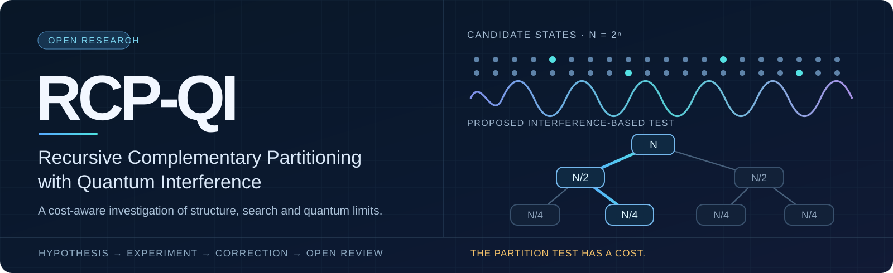
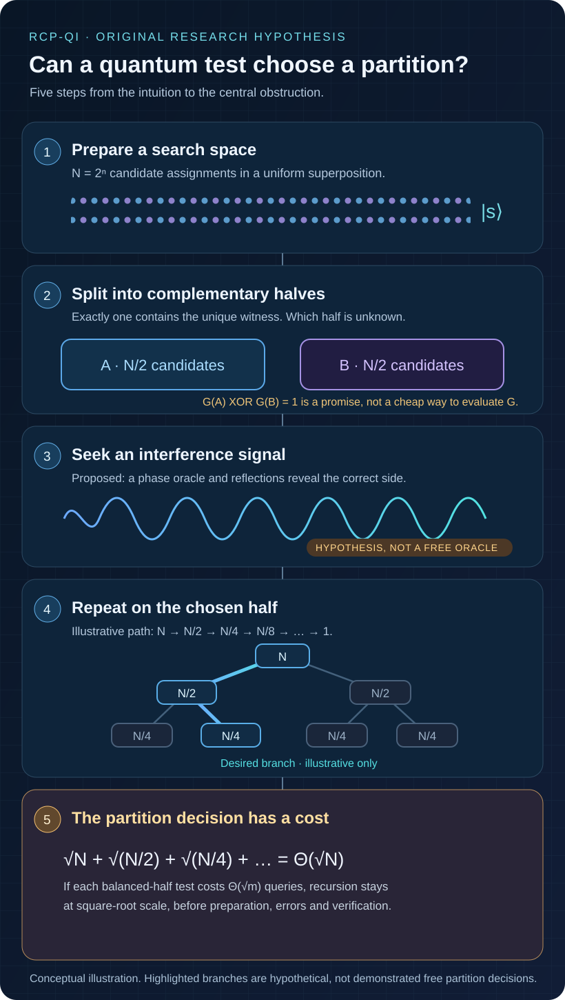
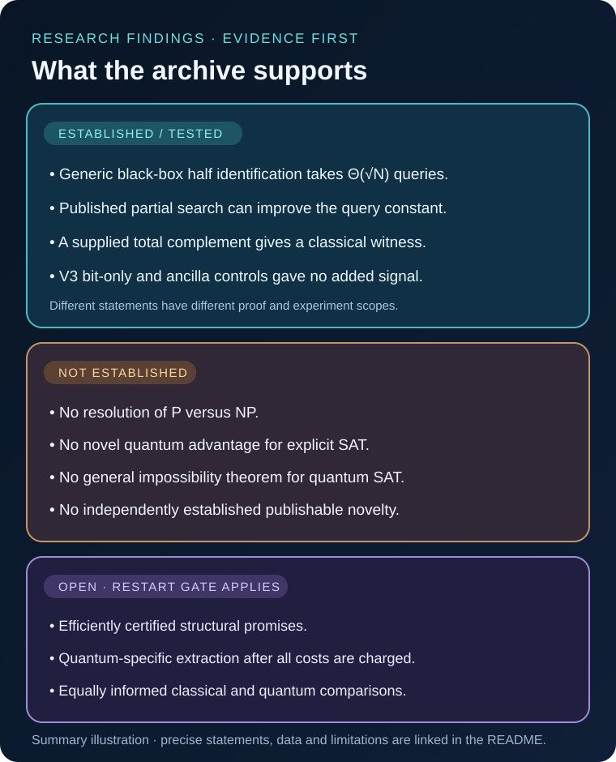
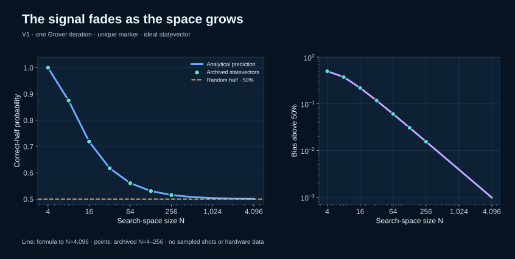
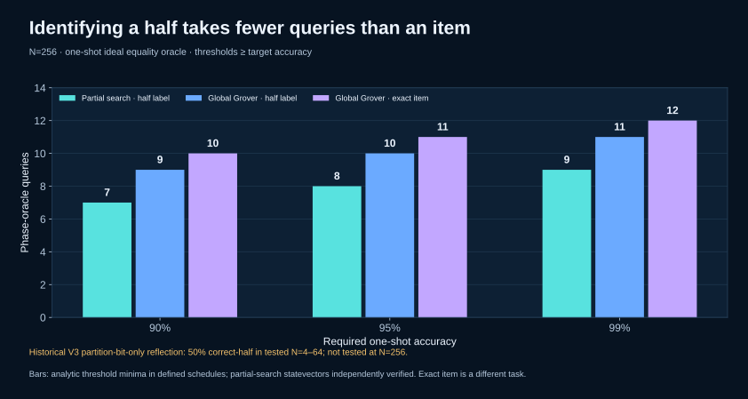
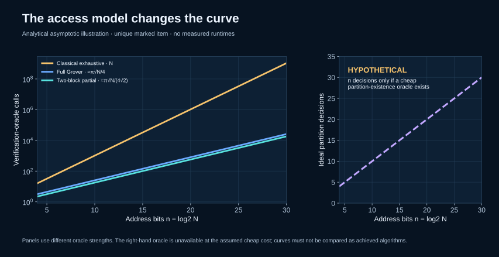
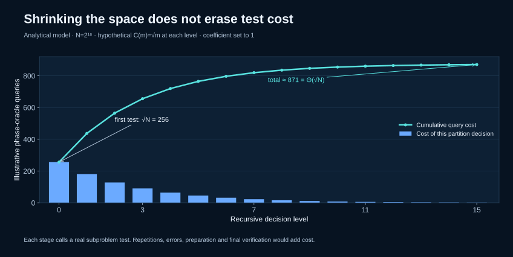
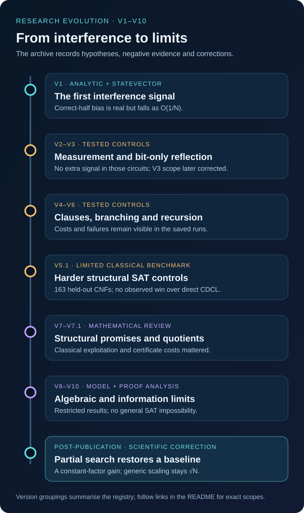

# RCP-QI

**Recursive Complementary Partitioning with Quantum Interference** asked whether quantum interference could reveal which half of a constraint search space contains a solution, cheaply enough to make recursive search useful. This repository is the reproducible V1–V10 research archive, including negative results and a post-publication correction.

**Status: SUSPENDED — PENDING NEW MATHEMATICAL INSIGHT.** The completed programme is open for mathematical review and collaboration; there is no active quantum architecture effort.

[](https://github.com/peterpapas/RCP-QI/actions/workflows/python-ci.yml) [](https://github.com/peterpapas/RCP-QI/actions/workflows/lean-ci.yml)

**The research question:** Can an efficiently certified property of an explicit, computationally meaningful constraint family support a quantum partition test whose *complete* cost beats equally informed classical and quantum methods? The original unique-solution promise says exactly one half contains the witness; it does not supply the test that identifies that half.

## The original idea, and its barrier



*Conceptual illustration.* The highlighted path is the desired outcome, not a demonstrated free partition choice. For a unique solution, `G(A) XOR G(B)=1` for disjoint exhaustive halves, but computing either existence bit is the hard step. [Grover–Radhakrishnan partial search](research/corrections/PARTIAL_SEARCH_PRIOR_ART.md) is established prior art: it can improve the constant for identifying a block while generic black-box search remains at `Θ(√N)` queries.

## What the archive supports



*Evidence summary.* The V3 correction matters: its historical “local” reflection acted on the **partition bit only**, so its negative result does not cover intra-block partial search. The [reviewer adjudication](research/corrections/REVIEWER_ADJUDICATION.md) records which claims changed. RCP-QI establishes no proof of `P=NP` or `P≠NP`, no novel quantum SAT speedup, and no universal impossibility theorem for quantum SAT.

## Evidence in four figures

### 1. A real signal that vanishes



*Analytical prediction and archived ideal-statevector observations.* After one Grover iteration, `P(correct half)=1/2+4/N−8/N²`. The source points are in [V1's unchanged result file](results/one_iteration.json); the curve beyond `N=256` is analytical, not new measurement. Repeating that fixed circuit independently to resolve its `Θ(1/N)` bias takes `Θ(N²)` samples. Other coherent algorithms are a different task and cost model.

### 2. Partial search restores a missing baseline



*Analytical threshold counts with statevector verification.* At `N=256`, the established global/local/final-global family reaches 90/95/99% **half-label** accuracy in 7/8/9 phase queries, versus 9/10/11 for the V2 global-Grover half-label control. Exact-item Grover answers a harder output task. The historical V3 partition-bit-only control stayed at 50% on its tested `N=4…64`; it was **not** tested at `N=256`. See the [corrected experiment, schedule restrictions and physical gate counts](research/corrections/PARTIAL_SEARCH_RESULTS.md).

### 3. The oracle model sets the scaling story



*Analytical and hypothetical comparison.* Classical exhaustive verification grows as `N`; full Grover and established two-block partial search have different `√N` coefficients under their stated high-success regimes. The dashed logarithmic panel assumes a cheap partition-existence oracle whose construction was never achieved. Its calls are **not interchangeable** with phase-oracle queries or explicit-SAT runtime.

### 4. Recursive decisions still add up



*Analytical model, not an observed runtime.* If a size-`m` half test costs `α√m` compatible queries, its idealized balanced recursion sums to roughly `α√N/(1−1/√2)`. Errors, repetitions, preparation and final witness verification add costs. The [partial-search review](research/corrections/PARTIAL_SEARCH_PRIOR_ART.md) states the exact-versus-bounded-error limits of this argument.

The [V5.1 classical SAT plots](results/processed/v5_1/) retain timeouts and resource limits: one small 256-variable local improvement over prefix branching did **not** beat direct modern SAT solving in the saved study. These wall-clock results are deliberately separate from quantum query charts.

## Research evolution



*Archive map, not a claim of continuous algorithmic progress.* The [version registry](research/experiment_registry.md), [roadmap](research/roadmap.md) and [full closeout report](research/archive/RCPQI_FINAL_RESEARCH_REPORT.md) give the exact scope, seeds and disposition of each phase.

## Formal verification and reproduction

[Lean 4 modules](formal/lean/) check specific Boolean and arithmetic identities, modelling lemmas, reductions and restricted soundness results. They do **not** formalise external quantum-search lower bounds, the Qiskit circuits or a P-versus-NP claim. Read the [theorem catalogue](THEOREMS.md) and [formal-status audit](theory/formal_status.md) before citing a statement.

With Python 3.12 and [uv](https://docs.astral.sh/uv/):

```sh
uv sync --locked
uv run pytest -q
uv run python scripts/validate_results.py
uv run python scripts/validate_partial_search.py
uv run python scripts/build_readme_figures.py --check
```

Run Ruff, the three V5.1 validators, archive integrity checks and the pinned Lean build using the [complete reproducibility instructions](research/archive/RCPQI_REPRODUCIBILITY.md). Regenerate the four README charts with `uv run python scripts/build_readme_figures.py`; [figure provenance and design notes](docs/README_VISUAL_DESIGN.md) explain every visual.

## Explore the archive

| Start here | What it contains |
| --- | --- |
| [Mathematical foundations](theory/mathematical_foundations.md) · [architecture](docs/architecture.md) | The original model and its cost assumptions |
| [Prior art](research/literature_review.md) · [scientific correction](research/corrections/FINAL_CORRECTION_REPORT.md) | Published comparators and corrected V3 scope |
| [Results](results/) · [experiment registry](research/experiment_registry.md) | Raw data, reproducible controls and limitations |
| [Negative results](NEGATIVE_RESULTS.md) · [final report](research/archive/RCPQI_FINAL_RESEARCH_REPORT.md) | Rejected mechanisms and the complete closeout |
| [Lean](formal/lean/) · [theorem catalogue](THEOREMS.md) | Machine-checked statements and their limits |
| [Source](src/rcp_qi_research/) · [tests](tests/) | Python implementations and validation |
| [Restart protocol](research/archive/RCPQI_RESTART_PROTOCOL.md) · [contribution guide](CONTRIBUTING.md) | Requirements for an independently reviewed new direction |

Future questions about certifiable structure, decoding and promised families remain **questions**, not an active V11 plan. Contributions should identify a precise mathematical property, charge discovery and oracle construction, compare equally informed baselines, and address prior negative findings. See [licensing](LICENSING.md), [citation metadata](CITATION.cff) and the [original publication README](README_AT_PUBLICATION.md).
