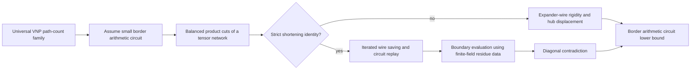

# V8 proof-technique analysis

The following reconstructs the **authors' claimed proof architecture**, not an independent proof of their hard lemmas. Source: pinned [Anthropic paper](https://github.com/anthropics/formal-math/blob/11b6c7e3c927df2658f513b6b68ea7f8929c62c5/vp-vnp/paper.pdf), especially §§2–3 and Appendices M–Q; pinned [OpenAI paper](https://github.com/openai/math/blob/3344da59991ed94f9ba711217b29c1d760badfa6/preprints/VP-and-VNP-are-different-November-23-2026/paper.pdf), especially §§2–5. The two routes have a family resemblance through tensor networks and cuts, but their invariants and quantitative claims differ.

## Anthropic: spectral price or contraction

The proposed invariant is a multiplicative/subadditive *spectral point* on multipartite tensors. Its value on identity wires induces a pseudometric `dφ`; circuit decomposition into balanced low-rank cuts upper-bounds spectral value by a function of circuit size. The authors claim a dichotomy:

```mermaid
flowchart LR
  A[Formal polynomial circuit] --> B[Balanced-cut tensor decomposition]
  B --> C[Spectral wire prices and CAT(0) geometry]
  C --> D{Flat or contracting field case}
  D -->|flat| E[Euclidean metric on complete wire network]
  E --> F[Network length exceeds low-rank cut budget]
  D -->|contracting| G[Tensor identities and cuttable counting programs]
  G --> H[Iterated accelerator and diagonal contradiction]
  F --> I[Arithmetic HC/permanent lower bound]
  H --> I
```

In the flat case, an explicit wire-network polynomial has a known spectral price; an assumed small arithmetic circuit gives too-cheap balanced terms. In the contracting case, universal spectral inequalities are converted to tensor identities, then to a hypothetical counting-program accelerator, iterated and diagonalized. The paper's separate reductions carry the network polynomial to Hamiltonian cycle and to permanent when characteristic is not two. The border result uses Laurent-series approximation. The paper itself identifies two points requiring **formal polynomial identity**: extracting block-multilinear and low-degree components at circuit gates. Those points fail when a Boolean circuit merely agrees on `{0,1}^n`; `x²−x` terms can change the formal components while vanishing on every Boolean input. The paper calls the construction a **lower bound**, not a fast SAT solver or quantum procedure.

## OpenAI: tensor wire rigidity or replay

The 23 November paper uses a universal VNP coefficient family: each coefficient counts accepting paths of a bounded-time universal machine. It prices a width-`b` tensor cable by `b × Euclidean distance`. The proposed hinge asks whether a fixed multi-diameter crossing tensor admits a *strict shortening* by a finite sum of cheaper networks.



Without shortening, an expander wire tensor and balanced-cut decomposition allegedly force a gate lower bound. With shortening, the fixed identity is used to replay candidate circuits inside a counted contraction; a boundary lemma uses algebraic geometry, finite-field reduction and residue/eigenvector data to handle degenerating constants, and diagonalization contradicts a small border circuit. This is not an executable shortcut for arbitrary CNF. The paper's strong `exp(Ω((log n)^(5/4)))` **border** claim is not the same as the formalized exact superpolynomial separation described in the repo's Lean scope document.

## Mechanism inventory and transfer test

| Ingredient | Claimed obstruction | Algebraic-only dependency | Plausible RCP-QI use and immediate obstacle |
| --- | --- | --- | --- |
| Balanced cuts | Small arithmetic circuit induces controlled-rank terms across some variable partition | Extracting homogeneous/set-multilinear polynomial components through cancellations | Could define a structural partition invariant, but a CNF's Boolean function permits arbitrary `x_i²−x_i` rewriting; low rank of one cut does not find a witness. |
| Spectral/tensor price | Network wire information cannot all be compressed into low-cost circuit terms | Tensor restriction and polynomial coefficient equality | Candidate lower-bound tool for **specified arithmetic tensor-network operator**, not a general quantum circuit bound. |
| Algebraic geometry/border | Degenerating circuits cannot escape coefficient-space obstruction | Zariski closure, field extensions, formal coefficients | Warns that numerical approximations and symbolic border complexity are different resources; no partition oracle follows. |
| Diagonal replay | Hypothetical cheap circuits would accelerate a counting program until self-contradiction | Nonuniform circuit advice and formal coefficient identities | May motivate scoped impossibility models; no uniform SAT or quantum lower bound without a new simulation theorem. |
| Partial/shifted derivatives, PIT, GCT | Existing measures and barriers for restricted algebraic models | Formal polynomial access | Literature controls. Neither pinned proof identifies a new SAT promise or uses quantum amplitude extraction. |

**Relevance decision:** Gate 1 passes only at the level of an *analytic analogy*: both papers measure cross-partition tensor information, the same type of object one might assign to a clause factor graph. Gate 2 fails for unrestricted SAT/quantum transfer because the required formal-polynomial identity and circuit restrictions are absent. No constructive algorithm or independent quantum mechanism is derived.
